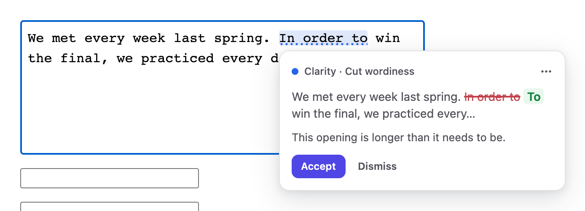
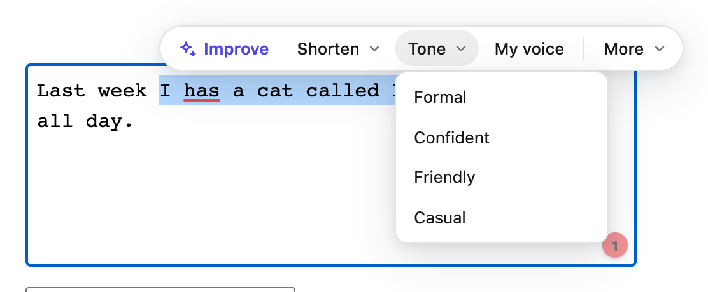
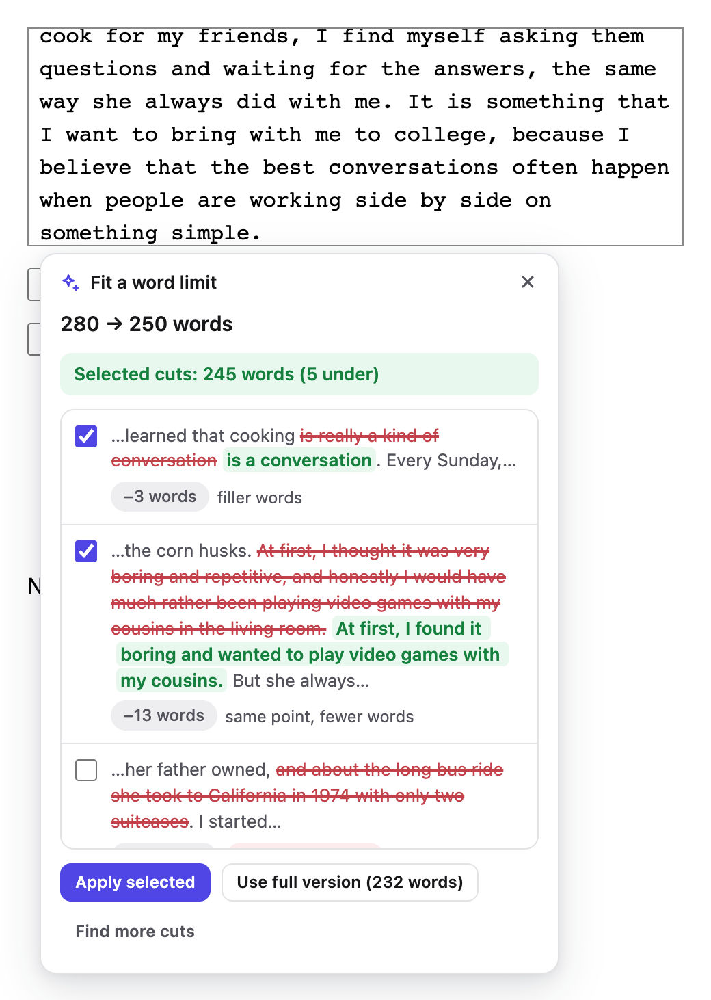
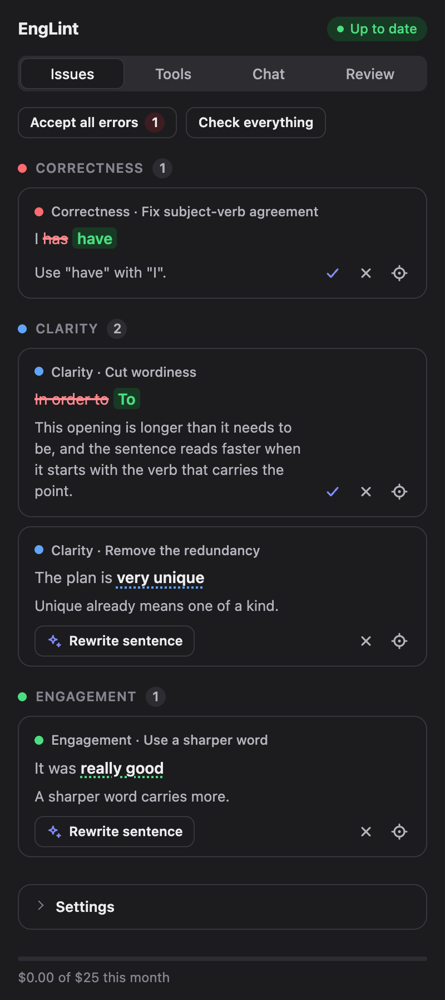
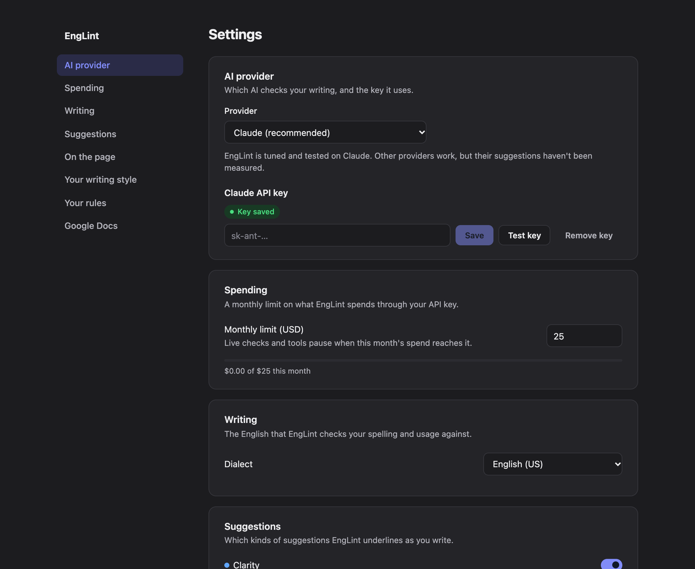
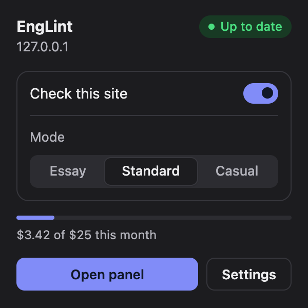

<div align="center">


# EngLint

**A writing assistant for Chrome that runs on your own AI key.**

Grammar, clarity and style checks as you type, with rewrites, a chat and a full essay review. Your text goes only to the provider you choose.

[](https://github.com/3xyy/EngLint/actions/workflows/ci.yml)
[](LICENSE)


</div>

---

## Why EngLint

Most writing assistants lock their best suggestions behind a subscription and send your writing through their own servers. EngLint is different on both counts:

- **You bring the key.** Use Claude, or any OpenAI-compatible provider, and pay that provider directly for what you use.
- **You stay in control.** A spending limit, real token accounting and no telemetry come built in.
- **It sees your context.** Underlines appear in Google Docs, Gmail, rich editors and plain text boxes alike.

## Highlights

| | |
|---|---|
| **Live checks** | Spelling, grammar and punctuation, plus clarity, word-choice and tone suggestions. Every card names the kind of change ("Clarity · Cut wordiness") and shows the edit inside your sentence, one click to accept. |
| **Instant local checks** | [Harper](https://writewithharper.com) runs in the browser as WebAssembly. Common mistakes are flagged in milliseconds, without that text leaving your machine. |
| **Rewrite bar** | Highlight anything for a compact bar: Improve, Shorten, Tone, My voice and more. Follow up in plain words ("make it punchier") right in the results. |
| **Fit a word limit** | Over a limit? Pick a target and EngLint suggests specific cuts, each with its word savings, and counts as you choose. Cuts that would change a fact are flagged, never pre-selected. |
| **Writing modes** | Essay mode leads with comments instead of rewriting your voice. Standard and Casual fit everyday writing. Each site remembers its mode, and essay sites start in Essay. |
| **Essay review** | A side panel with document stats and tone, reactions from different readers, a grader that scores you against your own rubric, a whole-text deep check, and a citation finder backed by web search (on Claude). |
| **Chat** | Ask about the text you're writing. Answers can propose edits you apply in one click. |
| **Learns your style** | A personal dictionary, "stop suggesting this" rules per mode, and an optional style profile that keeps rewrites in your voice. |
| **Any provider** | Claude is the default, and EngLint is tuned and tested on it. OpenAI, Google Gemini, OpenRouter, Groq, Ollama, LM Studio and custom endpoints work too. |

## Screenshots

<table>
  <tr>
    <td width="50%"></td>
    <td width="50%"></td>
  </tr>
  <tr>
    <td align="center"><sub>Every suggestion says what kind of change it is</sub></td>
    <td align="center"><sub>The rewrite bar, with tones one click away</sub></td>
  </tr>
  <tr>
    <td></td>
    <td></td>
  </tr>
  <tr>
    <td align="center"><sub>Cut an essay to its limit, one suggestion at a time</sub></td>
    <td align="center"><sub>The side panel, in dark mode</sub></td>
  </tr>
  <tr>
    <td></td>
    <td></td>
  </tr>
  <tr>
    <td align="center"><sub>Settings</sub></td>
    <td align="center"><sub>The popup</sub></td>
  </tr>
</table>

## Install

EngLint isn't on the Chrome Web Store yet. Build it from source:

```bash
git clone https://github.com/3xyy/EngLint.git
cd EngLint
npm install
npm run build
```

Then open `chrome://extensions` (or `brave://extensions`), turn on **Developer mode**, choose **Load unpacked**, and select `.output/chrome-mv3`. Open EngLint's settings, pick a provider and add your API key.

## Choose your AI

| Provider | Setup |
|---|---|
| **Claude** (recommended) | An API key from the Claude Console. |
| **OpenAI, Gemini, OpenRouter, Groq** | Your key for that provider, plus a fast and a smart model chosen from its own model list. |
| **Ollama, LM Studio** | Runs on your computer. No key needed. |
| **Custom endpoint** | Any OpenAI-compatible URL (https, or http on localhost). |

Spending is computed from each response's real token usage. Enter a model's prices to have it count toward your monthly limit.

## Privacy

- **Your API key** lives only in the extension's background worker. Web pages and content scripts never see it, and each key is sent only to the address it was saved for.
- **Your text** goes only to the provider you chose, and only to check it. Local checks never leave the browser.
- **No telemetry** and no typing logs. Settings stay on your machine.

## Development

```bash
npm run dev        # build and reload while you work
npm test           # unit tests (Vitest)
npm run typecheck  # TypeScript, strict
npm run e2e        # end-to-end tests (Playwright, against a local mock API)
npm run build      # production build in .output/chrome-mv3
```

Quality evals in `evals/` measure suggestion precision, rewrite quality and review accuracy against the real Claude API. They read `ANTHROPIC_API_KEY` from a local `.env` file, and each run costs a few cents.

### Project structure

| Path | What's there |
|---|---|
| `src/background/` | The service worker: model clients, prompts, caching, spending and key storage |
| `src/content/` | Field detection, editor adapters (textarea, rich editors, Google Docs) and the shadow-DOM overlay |
| `src/core/` | Pure logic: issue matching, diffs, modes, kinds, costs and schemas |
| `src/entrypoints/` | The side panel, popup, settings page and offscreen document |
| `src/shared/` | The design system, shared controls and messaging |
| `tests/` | Unit tests, end-to-end tests and fixtures |
| `evals/` | Quality evals and their fixtures |

## License

[MIT](LICENSE) © 2026 Yuvraj Dar. Third-party notices are in [public/NOTICE.txt](public/NOTICE.txt).
